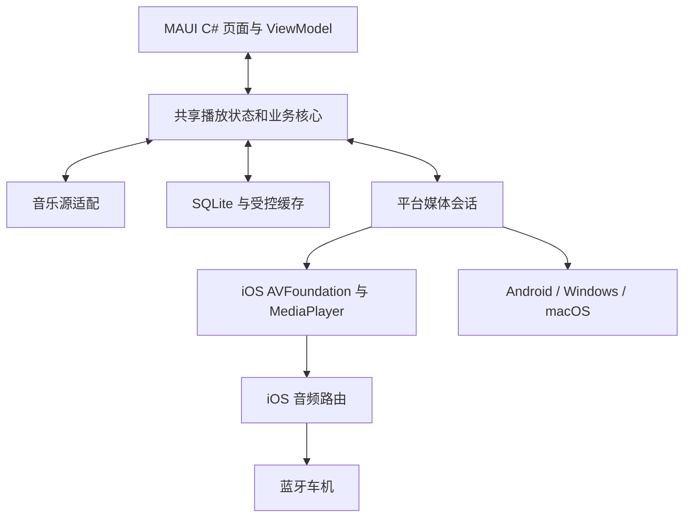

# Lyrava 技术架构

状态：设计基线，尚未实现。决策见 [ADR 0001](adr/0001-platform-and-distribution.md)。

## 产品链路

## 工程边界

初始工程在 M0-02 建立，按实际实现创建目录，当前不生成空项目来冒充可运行产品。

| 计划单元 | 职责 | 边界 |
| --- | --- | --- |
| `Lyrava.App` | MAUI C# 页面、ViewModel、依赖装配与平台目录 | 视图不拥有长期播放器生命周期 |
| `Lyrava.Core` | 领域模型、队列、播放状态、收藏/歌单业务和接口合同 | 不引用 MAUI 或平台媒体类型 |
| `Lyrava.Sources.YouTube` | 搜索/浏览/账号、媒体解析、版本和协议适配 | 不操作 UI；不把凭据泄漏到日志 |
| `Lyrava.Storage` | SQLite、迁移、缓存索引、下载记录 | 媒体文件与元数据分离；有配额和完整性检查 |
| `Lyrava.Core.Tests` 等 | 状态转换、队列、持久化和协议合同测试 | mock 不替代真实源、真机或车机验证 |

先保持这些职责边界。程序集数量随必要依赖确定，不引入微服务或抽象框架作为首版前提。

## 播放与平台适配

- 共享层持有队列和逻辑状态，平台层持有原生播放器与系统会话。通过命令和事件对接，界面只投影状态。
- iOS 首选 C# 绑定的 `AVPlayer` / `AVQueuePlayer`、`AVAudioSession`、`MPNowPlayingInfoCenter` 和 `MPRemoteCommandCenter`。
- Android 在 M3 接入原生媒体引擎、MediaSession 与前台媒体服务，适配代码用 C#。
- Windows 与 Mac Catalyst 在 M4 实现各自媒体会话、生命周期和窗口行为。
- 单一播放协调器负责用户命令、系统遥控、队列切换、中断、seek 与停止，防止页面重建产生重复播放器。
- 暂停、停止和销毁有明确语义；用户明确暂停后网络恢复不能擅自重新播放。
- 断开车机/耳机默认暂停；再次连接遵守用户设置与系统限制。强制退出后的蓝牙自动唤起不在承诺范围内。

## 音乐源与媒体传输

元数据查询、会话管理和可播放流解析分开封装。媒体解析结果至少包括媒体标识、编码/封装、必要请求信息、有效期和传输能力；这些字段不能直接序列化进公开日志。

M0 必须验证：

1. C# 音乐源实现的真实请求、签名和 token 能力。
2. 返回的格式可被目标系统播放；不假定 ExoPlayer 可播格式在 iOS 上同样可播。
3. HTTP Range、特殊请求头、seek 与到期刷新。
4. 后台状态下下一首解析和会话刷新；WebView 前台成功不代表后台可用。
5. 元数据请求和系统媒体请求的真实网络路线；`HttpClient` 代理设置不会自动证明 AVPlayer 路线一致。

初始架构没有必需的解析服务器。C# 端内实现若不能达到要求，应提交 ADR，清楚说明引入 WebView/JavaScript、Kotlin 组件或服务端会改变什么。维护者确定后再实施。SABR/特殊分块等非标准传输不在未验证时宣称为 AVPlayer 原生支持。

只提前准备有限数量后续曲目；不把整个歌单的临时 URL 当作长期缓存。按实际源站的有效期失效，并使用可取消、有限次数、带退避的重试。失败分类覆盖认证、区域/网络、内容不可用、解析变化、格式不支持与平台播放错误。

## 本地数据与下载

- SQLite 存放歌曲元数据、歌单、收藏、队列、进度、缓存/下载索引与模式版本。
- 媒体文件使用独立受控目录、容量配额、完整性校验和清理策略。
- token、cookie 和账号敏感材料使用操作系统安全存储；数据库、诊断包和源码仓不保存明文凭据。
- M1 提供有限播放缓存；M2 才承诺用户可管理的完整下载队列和离线冷启动。
- iOS 后台传输按系统能力实现，不依赖无限后台任务或伪造静音播放保活。
- 数据迁移在同 App ID 升级中验证；格式变化必须有兼容或明确拒绝策略。

## C#、AOT 与依赖

应用源代码使用 C#；系统框架和正常绑定属于原生平台依赖。不能因为调用入口是 C#，就把 Kotlin/Swift 业务库描述为 C# 实现。

iOS 依赖按其 AOT 和裁剪约束审查。不假设可以启动桌面子进程、运行桌面版下载工具、JIT 编译或动态加载未签名组件。JSON 优先使用源生成上下文；选择 SQLite、媒体或 token 库时逐项记录许可证、维护状态和设备兼容证据。

MAUI 10 生命周期到 2027-05-11。固定实际 SDK、MAUI workload、Xcode、平台最低版本和依赖版本；平台最低版本在 M0-03 根据真实测试矩阵确定，当前不随意承诺所有旧设备。

## 诊断与资源

诊断记录最后状态、错误类别、重试次数、平台/版本与匿名媒体上下文，不逐条泄漏请求。禁记 cookie、token、授权头、有效签名 URL、Apple 证书私钥和设备 UDID。

所有网络、预取、下载、刷新、观察器和播放器都有所有者、取消路径与资源回收。性能、耗电和内存用已固定设备及版本测量，再确定可执行阈值。
