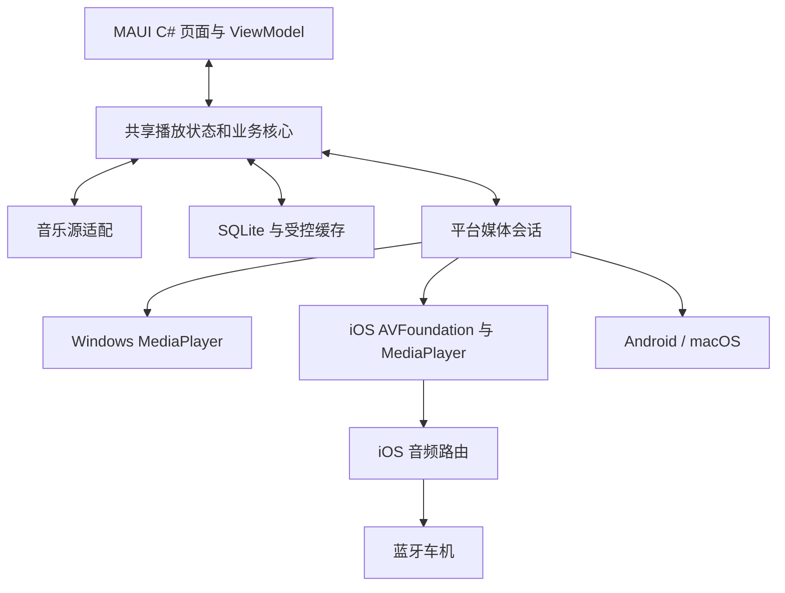

# Lyrava 技术架构

状态：Windows-only M0 工程基线和验证探针已完成，Windows 首发垂直切片已进入后续 M1 产品化；以下完整产品链路仍含计划能力。实际实现与门禁见 [M0 记录](m0-readiness.md)，方向决策见 [ADR 0001](adr/0001-platform-and-distribution.md)。

## 产品链路

## 工程边界

初始工程由 M0-02 建立。`Lyrava.slnx` 提供跨平台核心/源探针检查；`Lyrava.App.slnx` 提供独立 iOS MAUI 构建入口。只有实际实现的职责建立项目，存储等后续单元保留为计划。

| 单元 | 当前实现及后续职责 | 边界 |
| --- | --- | --- |
| `Lyrava.App` | 已有 C# 媒体验证页、平台无关播放服务合同、Windows `MediaPlayer` 播放切片和 iOS 原生播放器；产品页面仍待 M1 | 视图不拥有长期播放器生命周期 |
| `Lyrava.Core` | 已有曲目元数据、播放意图和中断/暂停状态合同；队列、收藏和歌单待 M1 | 不引用 MAUI 或平台媒体类型 |
| `Lyrava.Sources.YouTube` | 已有匿名搜索、直接 AAC/MP4 地址选择、有效期和 Range 探针；完整会话与播放可行性仍待证 | 不操作 UI；不把临时地址或凭据泄漏到日志 |
| `Lyrava.Storage`（计划） | SQLite、迁移、缓存索引、下载记录，当前未创建该工程 | 媒体文件与元数据分离；有配额和完整性检查 |
| `Lyrava.Core.Tests`、`Lyrava.Sources.YouTube.Tests` | 已有共享状态和 HTTP/协议合同测试；持久化等测试随实现引入 | fixture 不替代真实源、真机或车机验证 |

`tools/Lyrava.SourceProbe` 是有限的命令行可行性探针，不作为音乐播放器或源站兼容性承诺。保持这些职责边界，程序集数量随必要依赖确定，不引入微服务或抽象框架作为首版前提。

## 播放与平台适配

- 共享层持有队列和逻辑状态，平台层持有原生播放器与系统会话。通过命令和事件对接，界面只投影状态。
- Windows 首发使用 C# `Windows.Media.Playback.MediaPlayer`，由平台服务拥有媒体对象和生命周期；平台服务已接入 `SystemMediaTransportControls` 的播放/暂停/停止、元数据和时间线，系统级按键与窗口生命周期仍需独立运行验收。
- iOS 后续使用 C# 绑定的 `AVPlayer` / `AVQueuePlayer`、`AVAudioSession`、`MPNowPlayingInfoCenter` 和 `MPRemoteCommandCenter`。
- Android 在 M3 接入原生媒体引擎、MediaSession 与前台媒体服务，适配代码用 C#。
- Mac Catalyst 在 M4 实现媒体会话、生命周期和窗口行为；Windows 首发切片在 M1 继续扩展为产品能力。
- Android、iOS 和 Mac 的平台媒体层、签名、设备及车机验收不属于当前 Windows-only M0，按各自后续阶段独立实施。
- 单一播放协调器负责用户命令、系统遥控、队列切换、中断、seek 与停止，防止页面重建产生重复播放器。
- 暂停、停止和销毁有明确语义；用户明确暂停后网络恢复不能擅自重新播放。
- 断开车机/耳机默认暂停；再次连接遵守用户设置与系统限制。强制退出后的蓝牙自动唤起不在承诺范围内。

## 音乐源与媒体传输

元数据查询、会话管理和可播放流解析分开封装。媒体解析结果至少包括媒体标识、编码/封装、必要请求信息、有效期和传输能力；这些字段不能直接序列化进公开日志。

M0 必须验证：

1. C# 音乐源实现的真实请求、签名和 token 能力。
2. 返回的格式可被目标系统播放；不假定 ExoPlayer 可播格式在 iOS 上同样可播。
3. HTTP Range、特殊请求头、seek 与到期刷新。
4. 后台状态下下一首解析和会话刷新；WebView 前台成功不代表后台可用。
5. 元数据请求和系统媒体请求的真实网络路线；`HttpClient` 代理设置不会自动证明 AVPlayer 路线一致。

初始架构没有必需的解析服务器。C# 端内实现若不能达到要求，应提交 ADR，清楚说明引入 WebView/JavaScript、Kotlin 组件或服务端会改变什么。维护者确定后再实施。SABR/特殊分块等非标准传输不在未验证时宣称为 AVPlayer 原生支持。

只提前准备有限数量后续曲目；不把整个歌单的临时 URL 当作长期缓存。按实际源站的有效期失效，并使用可取消、有限次数、带退避的重试。失败分类覆盖认证、区域/网络、内容不可用、解析变化、格式不支持与平台播放错误。

## 本地数据与下载

- SQLite 存放歌曲元数据、歌单、收藏、队列、进度、缓存/下载索引与模式版本。
- 媒体文件使用独立受控目录、容量配额、完整性校验和清理策略。
- token、cookie 和账号敏感材料使用操作系统安全存储；数据库、诊断包和源码仓不保存明文凭据。
- M1 提供有限播放缓存；M2 才承诺用户可管理的完整下载队列和离线冷启动。
- iOS 后台传输按系统能力实现，不依赖无限后台任务或伪造静音播放保活。
- 数据迁移在同 App ID 升级中验证；格式变化必须有兼容或明确拒绝策略。

## C#、AOT 与依赖

应用源代码使用 C#；系统框架和正常绑定属于原生平台依赖。不能因为调用入口是 C#，就把 Kotlin/Swift 业务库描述为 C# 实现。

iOS 依赖按其 AOT 和裁剪约束审查。不假设可以启动桌面子进程、运行桌面版下载工具、JIT 编译或动态加载未签名组件。JSON 优先使用源生成上下文；选择 SQLite、媒体或 token 库时逐项记录许可证、维护状态和设备兼容证据。

MAUI 10 生命周期到 2027-05-11。固定实际 SDK、MAUI workload、Xcode、平台最低版本和依赖版本；平台最低版本在 M0-03 根据真实测试矩阵确定，当前不随意承诺所有旧设备。

## 诊断与资源

诊断记录最后状态、错误类别、重试次数、平台/版本与匿名媒体上下文，不逐条泄漏请求。禁记 cookie、token、授权头、有效签名 URL、Apple 证书私钥和设备 UDID。

所有网络、预取、下载、刷新、观察器和播放器都有所有者、取消路径与资源回收。性能、耗电和内存用已固定设备及版本测量，再确定可执行阈值。
